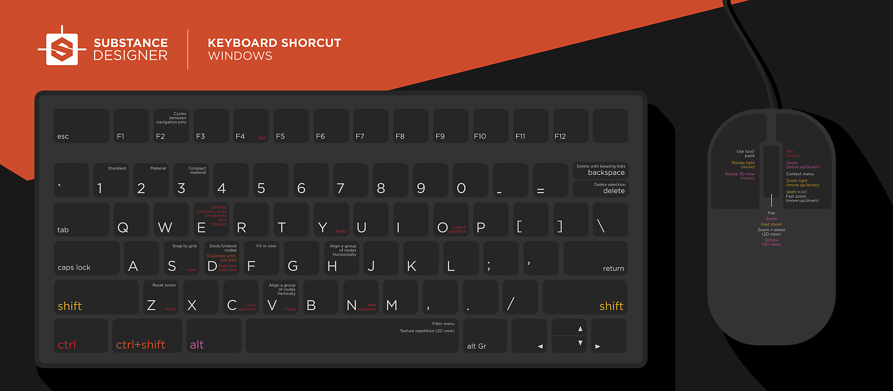
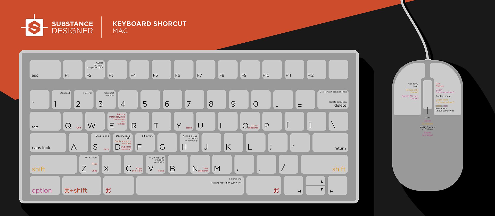

# Mét. abrev.

En esta página encontrará una descripción general de todos los métodos abreviados de Substance 3D Designer.

## Mapas clave

**Windows**

{zoomable="yes"}

**macOS**

{zoomable="yes"}

## Listas de accesos directos

### Global

| Acción | Windows | macOS |
|:------------------------|:-------------|:-------------|
| Gráfico de Substance nuevo | Ctrl + N | ⌘ + N |
| Cargar paquete | Ctrl + O | ⌘ + O |
| Guardar paquete | Ctrl + S | ⌘ + S |
| Guardar todos los paquetes | Ctrl + ⇧ + S | ⌘ + ⇧ + S |
| Deshacer | Ctrl + Z | ⌘ + Z |
| Rehacer | Ctrl + Y | ⌘ + Y |
| Menú contextual | RMB | RMB |
| Maximizar conjunto acoplado | ⇧ + Barra espaciadora | ⇧ + Barra espaciadora |
| Cambiar motores | F9 | F9 |
| Suspender el motor | ⇧ + Escape | ⇧ + Escape |

{style="table-layout:fixed"}

### Vista de gráfico

**Ventana**

| Acción | Windows | macOS |
|:----------------------|:---------------------------------------|:-------------------------------------|
| Zoom | MouseWheel Alt + RMB + Arrastrar | MouseWheel ⌥ + RMB + Arrastrar |
| Zoom rápido | ⇧ + MouseWheel  ⇧ + Alt + RMB + Arrastrar | ⇧ + MouseWheel  ⇧ + ⌥ + RMB + Arrastrar |
| Panorámica | MMB + Arrastrar Ctrl + RMB + Arrastrar | MMB + Arrastrar ⌘ + RMB + Arrastrar |
| Restablecer zoom | Z | Z |
| Encajar en la vista | F | F |
| Copiar | Ctrl + C | ⌘ + C |
| Pegar | Ctrl + V | ⌘ + V |
| Buscar | Ctrl + F | ⌘ + F |
| Menú Nodo | Barra espaciadora | Barra espaciadora |
| Pin de navegación de ciclo | F2 | F2 |

{style="table-layout:fixed"}

**Seleccionando**

| Acción | Windows | macOS |
|:--------------------------|:-------------------|:---------------|
| Seleccionar Agregar | Ctrl + A | ⌘ + A |
| Alternar seleccionados | Ctrl + LMB | ⌘ + LMB |
| Selección de recuadro (añadir) | Ctrl + LMB + Arrastrar | ⌘ + LMB + Arrastrar |
| Selección de recuadro (Restar) | Mayús + LMB + Arrastrar | ⇧ + LMB + Arrastrar |

{style="table-layout:fixed"}

**En elementos seleccionados**

| Acción | Windows | macOS |
|:------------------------------------|:-------------|:----------|
| Copiar selección | Ctrl + C | ⌘ + C |
| Duplicar selección | Ctrl + D | ⌘ + D |
| Duplicar sin vínculos | Ctrl + ⇧ + D | ⌘ + ⇧ + D |
| Eliminar selección | Eliminar | Eliminar |
| Eliminar selección y conservar vínculos | ⌫ | ⌫ |
| Acoplar/desacoplar nodo | D | D |
| Encajar en la vista | F | F |
| Abrir gráfico referenciado | ⌘ + E | ⌘ + C |
| Alinear nodos horizontalmente | H | H |
| Alinear nodos verticalmente | V | V |
| Ajuste de nodos a la cuadrícula | S | S |

{style="table-layout:fixed"}

**Conexiones de nodo**

| Acción en el conector | Windows | macOS |
|:---------------------|:-----------|:--------|
| Mover conexión | ⇧ + LMB | ⇧ + LMB |
| Nuevo desde el mismo origen | Ctrl + LMB | ⌘ + LMB |
| Eliminar conexión | Alt + LMB | ⌥ + LMB |

{style="table-layout:fixed"}

| Acción en vínculo | Windows | macOS |
|:---------------------------------|:----------|:--------|
| Cambiar vínculos (2 vínculos a la vez) | X | X |
| Añadir nodo de punto | Alt + LMB | ⌥ + LMB |

{style="table-layout:fixed"}

#### Solo gráficos de Substance

| Acción | Windows | macOS |
|:--------------------------------|:----------|:--------|
| Vista rápida en vista 2D (en el nodo) | Alt + LMB | ⌥ + LMB |
| Desactivar nodos | ⇧ + D | ⇧ + D |
| Exportación de salidas de gráficos | Ctrl + B | ⌘ + B |
| Borrar caché de nodo | F5 | F5 |
| Cancelar procesamiento de gráficos | Escapar | Escapar |

{style="table-layout:fixed"}

| Modos de creación de vínculos | Windows | macOS |
|:--------------------|:--------|:------|
| Estándar | 1 | 1 |
| Material | 2 | 2 |
| Material compacto | 3 | 3 |

{style="table-layout:fixed"}

>[!NOTE]
>
> Obtenga información sobre los modos de creación de vínculos en [esta página](../../interface/the-graph-view/link-creation-modes/link-creation-modes.md) de esta documentación.

### Vista 2D

| Acción | Windows | macOS |
|:---------------------|:---------------------------------------|:-------------------------------------|
| Zoom | MouseWheel Alt + RMB + Arrastrar | MouseWheel ⌥ + RMB + Arrastrar |
| Zoom rápido | ⇧ + MouseWheel  ⇧ + Alt + RMB + Arrastrar | ⇧ + MouseWheel  ⇧ + ⌥ + RMB + Arrastrar |
| Panorámica | MMB + Arrastrar Ctrl + RMB + Arrastrar | MMB + Arrastrar ⌘ + RMB + Arrastrar |
| Restablecer a una escala del 100 % | Z | Z |
| Encajar en la vista | F | F |
| Alternar la visualización en mosaico | Barra espaciadora | Barra espaciadora |

{style="table-layout:fixed"}

### Vista 3D

| Acción | Windows | macOS |
|:-----------------------------------------------------|:--------------------------------|:-----------------------------|
| Cámara dolly (panorámica hacia delante/hacia atrás) | MouseWheel Alt + RMB + Arrastrar | MouseWheel ⌥ + RMB + Arrastrar |
| Cámara orbital | LMB + Arrastrar | LMB + Arrastrar |
| Cámara de camión y pedestal (panorámica lateral y vertical) | MMB + Arrastrar Ctrl + RMB + Arrastrar | MMB + Arrastrar ⌘ + RMB + Arrastrar |
| Rotar entorno | Ctrl + ⇧ + RMB | Ctrl + ⇧ + RMB |
| Cambiar temporalmente a los controles de Luz de punto 1 | ⇧ (mantener) | ⇧ (mantener) |
| Luz de punto de órbita 1 | LMB + Arrastrar | LMB + Arrastrar |
| Luz Dolly Point 1 | RMB + Arrastrar | RMB + Arrastrar |
| Guardar procesamiento | Alt + S | ⌥ + S |
| Copiar procesamiento en el portapapeles | Alt + C | ⌥ + C |
| Restablecer posición de cámara | R | R |
| Restablecer estado de la cámara | ⇧ + R | ⇧ + R |
| Seleccionar malla (solo rasterizador y Trazador de ruta de GPU) | ⇧ + LMB | ⇧ + LMB |
| selección de marco | F | F |

{style="table-layout:fixed"}

### Explorer

| Acción | Windows | macOS |
|:----------------------------------|:----------|:-------|
| Cerrar los paquetes seleccionados | Ctrl + F4 | ⌘ + W |
| Recargar paquete/recurso | Ctrl + R | ⌘ + R |
| Cambiar nombre de recurso | F2 | F2 |
| Eliminar recurso | Eliminar | Eliminar |
| Cargar recurso en editor/visor | Intro | Intro |
| Paquete seleccionado de Publish a SBSAR | Ctrl + P | ⌘ + P |

{style="table-layout:fixed"}
